# Proof of Concept (PoC) Report: Enterprise Edge Firewall, Dual-ISP BGP/OSPF Routing and Perimeter Defense on Palo Alto PA-VM

**Author:** Thiều Đình Hưng  
**Platform:** Palo Alto Networks PA-VM (PAN-OS 10.1.0), Cisco IOL, EVE-NG  
**Type:** Simulated Lab / Proof of Concept (Not a production deployment)  

## Executive Summary
This PoC validates an enterprise edge design built around a single Palo Alto PA-VM firewall:
1. Collapsed-core (2-tier) campus (Core + Access) running OSPFv2 toward the firewall.
2. Dual-homed WAN edge with eBGP to two simulated ISPs, with primary/backup path selection and automatic failback.
3. Route-aware NAT: source NAT rules selected by egress interface, plus destination NAT to publish a DMZ web server.
4. Zone-based security policy using App-ID and least-privilege rules between Trust, DMZ, and Untrust.
5. Zone Protection against reconnaissance (TCP port scan) and SYN flood, tested from a Kali Linux attacker node.

*All results below come from lab testing. Where a figure or number is a measurement, it is stated as such; limitations are listed in Section 9.*

---

## 1. Architecture Overview

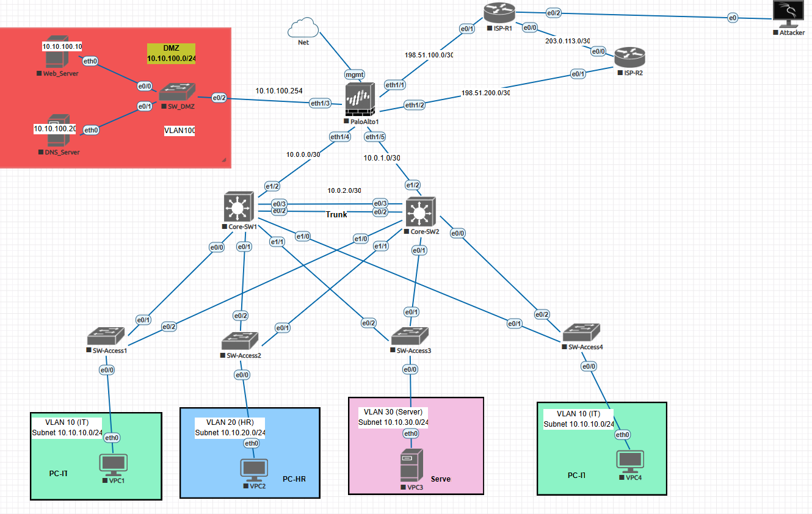

* Firewall (`PaloAlto1`) enforces policy between three zones: `Untrust` (dual-ISP edge), `DMZ` (10.10.100.0/24, VLAN 100), and `Trust` (internal campus).
* **Dual-ISP edge:** `eth1/1` (198.51.100.0/30) peers with ISP-R1 (AS 65001); `eth1/2` (198.51.200.0/30) peers with ISP-R2 (AS 65002). The ISP routers are linked by 203.0.113.0/30 and each hosts a loopback as a simulated Internet target (8.8.8.8 on ISP-R1, 1.1.1.1 on ISP-R2). A Kali Linux Attacker node attaches to ISP-R1 `e0/2`.
* **Campus (collapsed core, 2-tier):** Core-SW1 and Core-SW2 perform both core and distribution roles (SVIs, HSRP gateways, routing), with an LACP EtherChannel between them. Each core connects to the firewall over a routed /30 (`eth1/4` 10.0.0.0/30, `eth1/5` 10.0.1.0/30). Four access switches (SW-Access1..4) uplink to both cores and serve VLAN 10 (IT, 10.10.10.0/24), VLAN 20 (HR, 10.10.20.0/24), and VLAN 30 (Server, 10.10.30.0/24).
* **DMZ:** `eth1/3` (10.10.100.254/24) connects to SW_DMZ, hosting Web_Server (10.10.100.10) and DNS_Server (10.10.100.20).
* **Design choice:** A collapsed core was chosen because the campus is small; a separate distribution layer would add devices and configuration without adding value at this scale.

---

## 2. Interface Provisioning and Address Objects

### 2.1 Layer 3 Interfaces and Zones

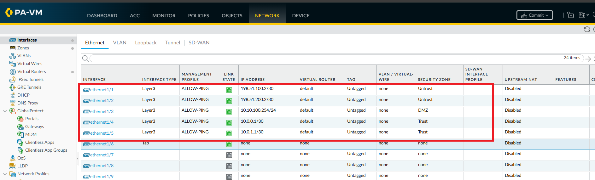

* `ethernet1/1` to `ethernet1/5` are Layer 3 interfaces in virtual router `default`, with management profile `ALLOW-PING` for diagnostics.
* Both WAN interfaces (198.51.100.2/30, 198.51.200.2/30) belong to one `Untrust` zone, so a single set of inter-zone rules covers both ISPs.
* `ethernet1/3` is the DMZ gateway; `ethernet1/4` and `ethernet1/5` are routed point-to-point uplinks to the cores, both in `Trust`.
* A loopback interface in `Untrust` carries the simulated public addresses (192.0.2.1, 192.0.2.10/32).

### 2.2 Address Objects

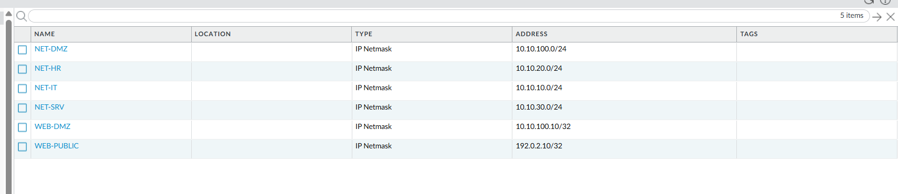

* Networks are defined as objects: `NET-IT`, `NET-HR`, `NET-SRV`, `NET-DMZ`.
* The web server is split into the real address `WEB-DMZ` (10.10.100.10/32) and the public virtual IP `WEB-PUBLIC` (192.0.2.10/32). This separation is what the destination NAT and the security rules rely on.

---

## 3. Interior Routing (OSPFv2) and Redistribution

### 3.1 Point-to-Point Interfaces and Path Cost

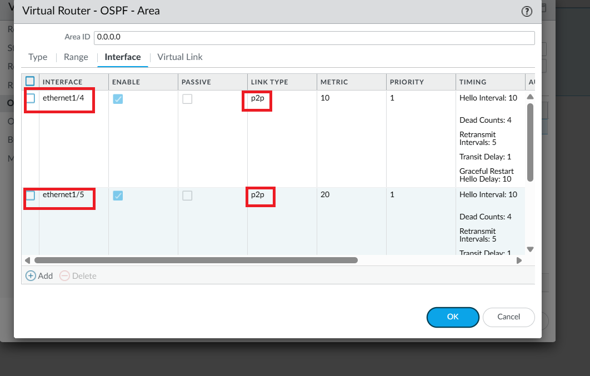

* `ethernet1/4` and `ethernet1/5` are in Area 0.0.0.0 with link type `p2p`, which avoids DR/BDR election on these two-node links.
* Cost is 10 on `ethernet1/4` (preferred, via Core-SW1) and 20 on `ethernet1/5` (backup, via Core-SW2), ensuring return traffic prefers the same core that is HSRP active.

### 3.2 Passive Interface on the DMZ

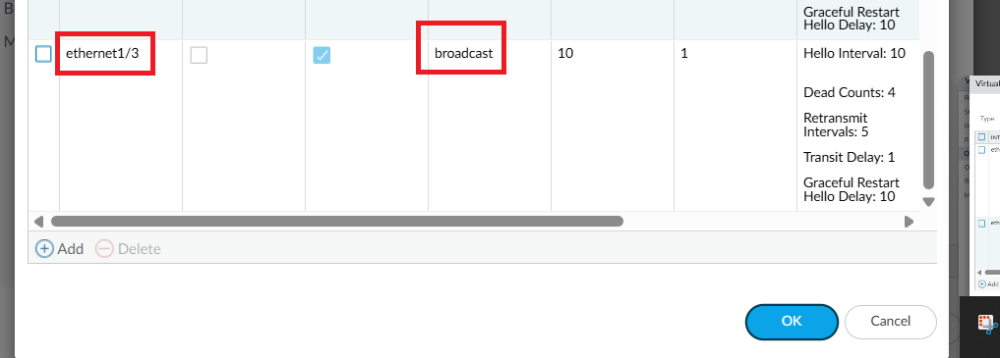

* `ethernet1/3` is passive: the DMZ subnet is advertised to the cores, but no OSPF hellos are sent into the DMZ, ensuring a compromised DMZ host cannot form an OSPF adjacency with the firewall.

### 3.3 Injecting the BGP Default Route into OSPF

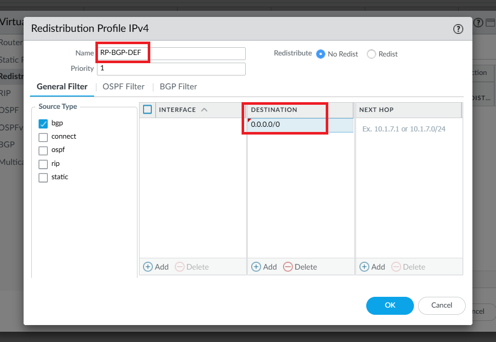  
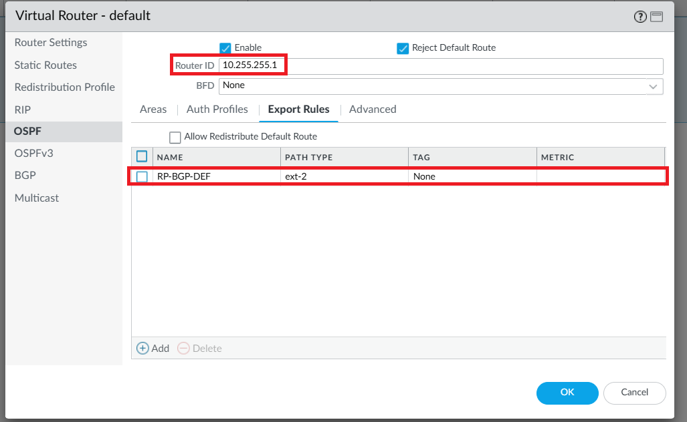

* Profile `RP-BGP-DEF` (priority 1) matches source type `bgp` and destination `0.0.0.0/0` only.
* It is exported into OSPF as External Type 2 (`ext-2`), ensuring only the default route reaches the cores and Internet prefixes stay out of the OSPF database.

### 3.4 Adjacency Verification

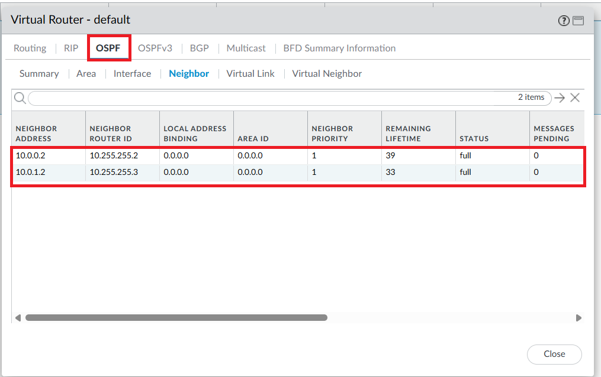

* The firewall shows full adjacency in Area 0.0.0.0 with 10.0.0.2 (Router ID 10.255.255.2, Core-SW1) and 10.0.1.2 (Router ID 10.255.255.3, Core-SW2).

---

## 4. Exterior Routing: Dual-ISP eBGP

### 4.1 Global BGP Parameters

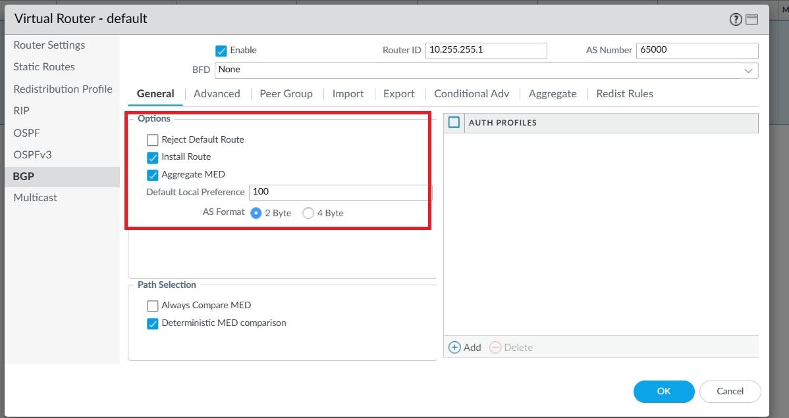

* Local AS 65000, Router ID 10.255.255.1, `Install Route` enabled.
* `Reject Default Route` is unchecked so the firewall accepts the default route originated by each ISP. Default local preference is 100.

### 4.2 Peer Groups and Peers

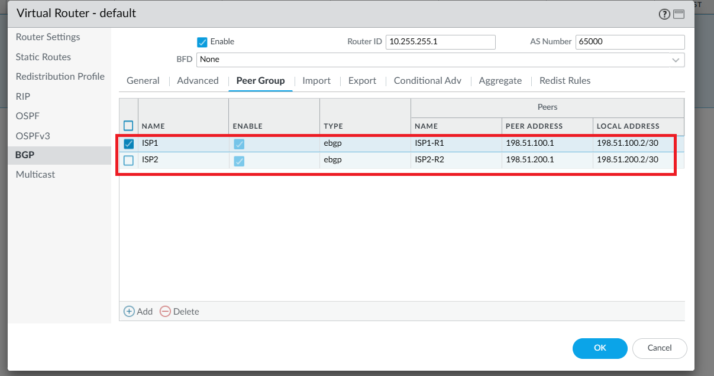  
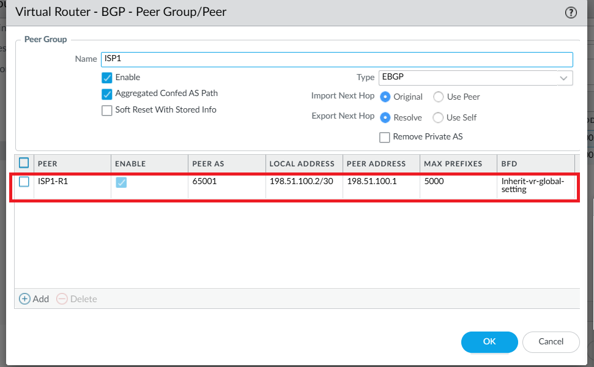  
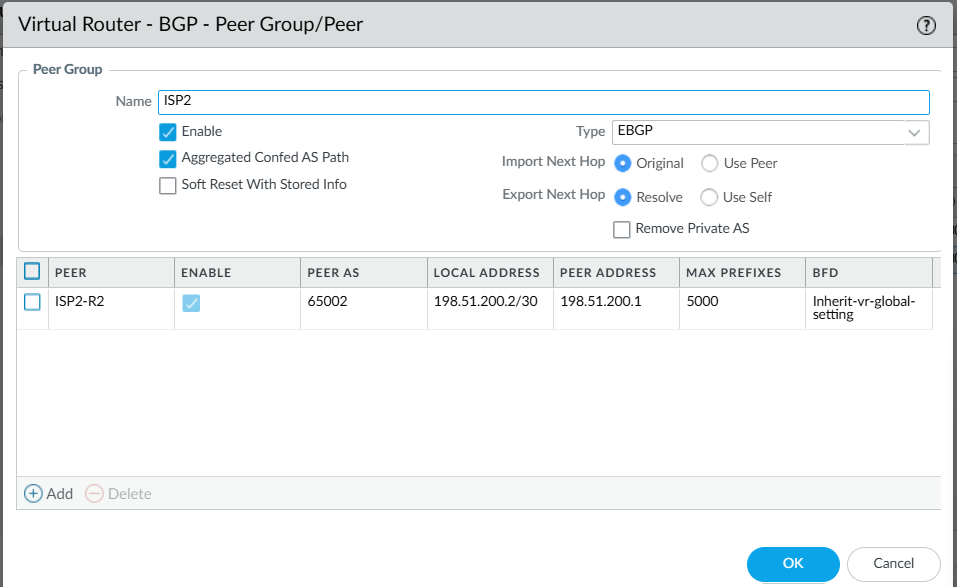

* Two eBGP peer groups are established (one per ISP) so each ISP can have an independent import/export policy.
* Both peers have `Max Prefixes 5000` to protect the control plane against route leaks.

### 4.3 Path Selection and Export Filtering

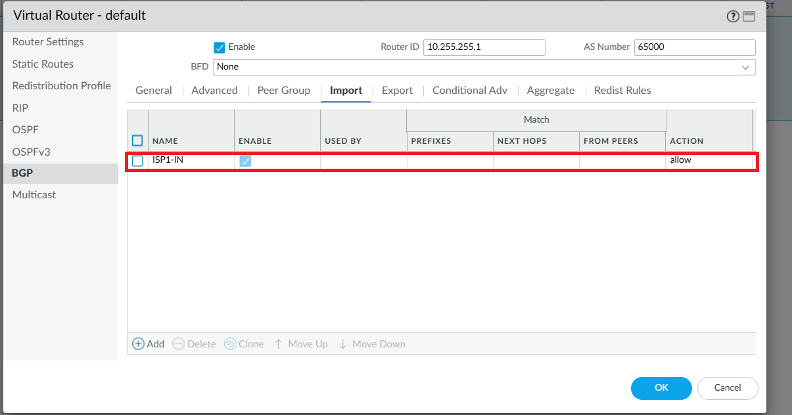  
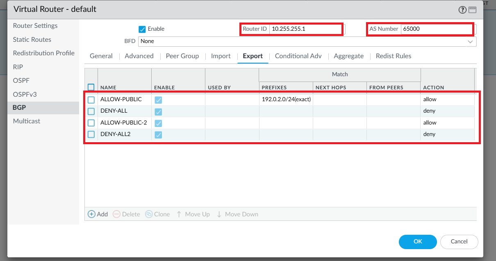

* **Outbound path selection:** Import rule `ISP1-IN` raises local preference for routes learned from ISP1, establishing ISP1 as the preferred exit and ISP2 as the backup.
* **Anti-transit export policy:** An allow rule permits only the public host route to be advertised, followed by `DENY-ALL` / `DENY-ALL2`. This stops the firewall from re-advertising routes learned from one ISP to the other (becoming a transit AS) and prevents leaking RFC 1918 prefixes.

**Verification:**  
Executing `show ip bgp 8.8.8.8` on ISP-R2 confirms the filter operates correctly, showing only the direct ISP-to-ISP path with no AS 65000 in the transit path:
```text
ISP-R2# show ip bgp 8.8.8.8
BGP routing table entry for 8.8.8.8/32, version 4
Paths: (1 available, best #1, table default)
  Not advertised to any peer
  Refresh Epoch 1
  65001
    203.0.113.1 from 203.0.113.1 (198.51.100.1)
      Origin IGP, metric 0, localpref 100, valid, external, best
```

### 4.4 Public Prefix Advertisement

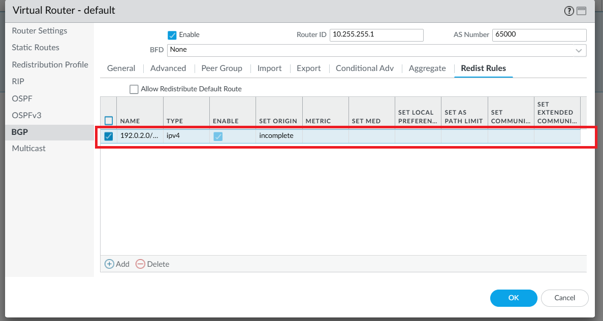  
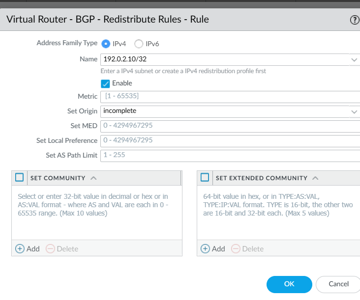

* The web VIP is advertised as a host route `192.0.2.10/32`. On PAN-OS, a loopback address is inherently installed as a /32.

### 4.5 Session State

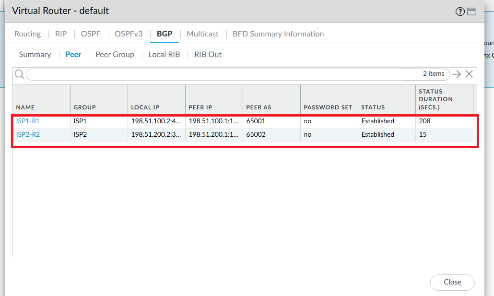

* Both sessions (198.51.100.1 and 198.51.200.1) are currently `Established`.

---

## 5. NAT and Security Policy

### 5.1 NAT Policy

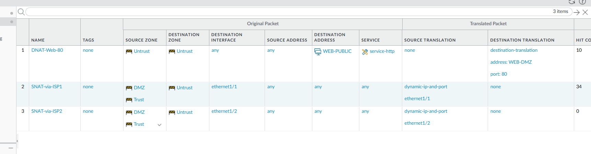

* **DNAT (`DNAT-Web-80`):** Source and destination zones are both `Untrust` in the Original Packet, matching the pre-NAT destination (`WEB-PUBLIC`). The destination is translated (Static IP) to `WEB-DMZ` on port 80, and the post-NAT route lookup places the packet in the `DMZ`.
* **SNAT (`SNAT-via-ISP1`, `SNAT-via-ISP2`):** Utilizes Dynamic IP and Port using the egress interface address. The rules are separated by Destination Interface (`ethernet1/1` / `ethernet1/2`), guaranteeing the correct public address is applied dynamically based on active routing.
* With ISP1 active, `SNAT-via-ISP1` registers 34 hits while `SNAT-via-ISP2` registers 0.

### 5.2 Security Policy

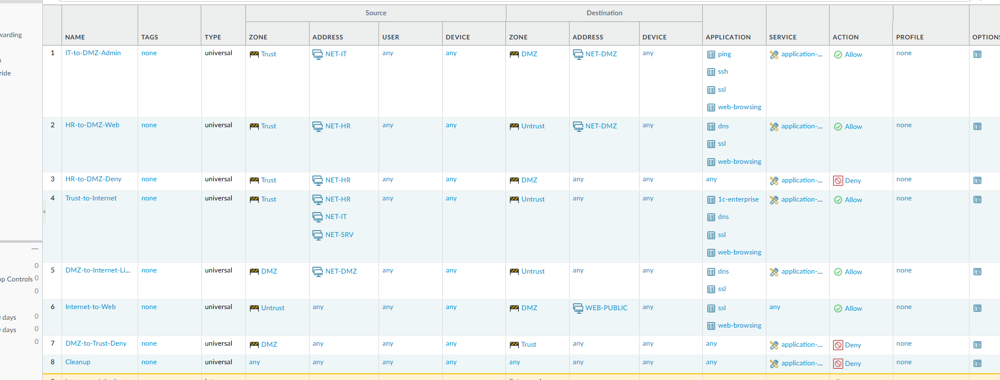

1. `IT-to-DMZ-Admin`: `NET-IT` (Trust) to `NET-DMZ`, applications `ping`, `ssh`, `ssl`, `web-browsing`, service `application-default`.
2. `HR-to-DMZ-Web` & `HR-to-DMZ-Deny`: HR may use `dns`, `ssl`, `web-browsing` toward the DMZ; everything else from HR to the DMZ is explicitly denied.
3. `Trust-to-Internet`: Outbound access for approved applications.
4. `Internet-to-Web`: Destination address is the pre-NAT `WEB-PUBLIC`, destination zone is the post-NAT zone `DMZ`; only `web-browsing` and `ssl` are allowed.
5. `DMZ-to-Trust-Deny`: Blocks connections initiated from the DMZ toward the internal network, mitigating lateral movement from a compromised server.
6. `Cleanup`: Explicit deny with active logging.

### 5.3 Security Profiles

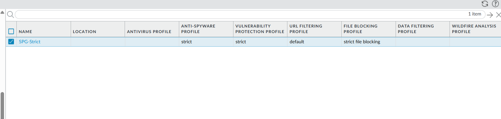  

* `SPG-Strict` combines Anti-Spyware (strict), Vulnerability Protection (strict), URL Filtering (default), and File Blocking (strict).
* *Limitation:* The PA-VM in this lab lacks a Threat Prevention license, meaning signature-based IPS was configured but bypassed at the dataplane. L3/L4 controls (routing, NAT, App-ID rules, Zone Protection) were fully validated.

---

## 6. Policy and NAT Functional Verification

### 6.1 IT to DMZ (Allowed)
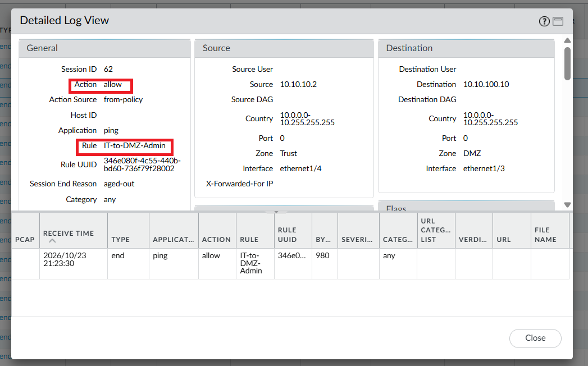
* Application `ping`, action `allow`, rule `IT-to-DMZ-Admin`. Source 10.10.10.2 (Trust) to 10.10.100.10 (DMZ).

### 6.2 Outbound Internet with Source NAT
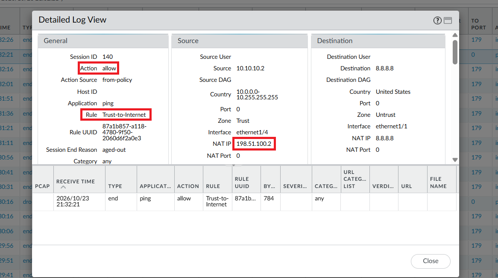
* Application `ping`, rule `Trust-to-Internet`, destination 8.8.8.8. Source 10.10.10.2 is translated to 198.51.100.2, confirming `SNAT-via-ISP1`.

### 6.3 HR to DMZ (Denied)
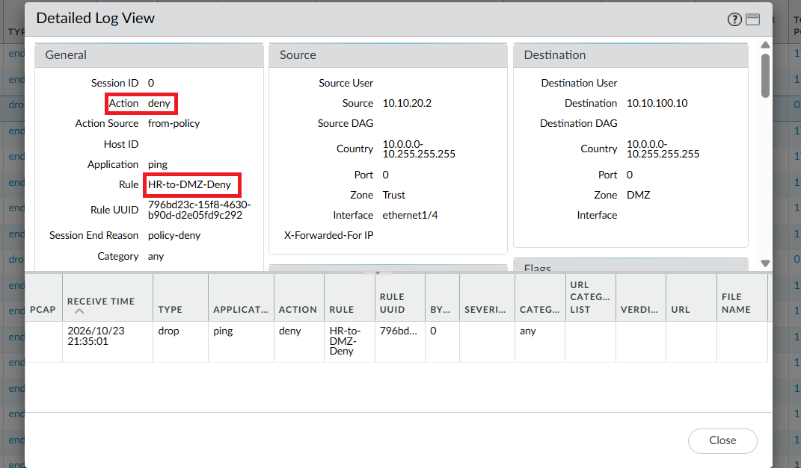
* Action `deny`, rule `HR-to-DMZ-Deny`. Source 10.10.20.2 (Trust) to 10.10.100.10 (DMZ) blocked.

### 6.4 DMZ to Trust (Denied)
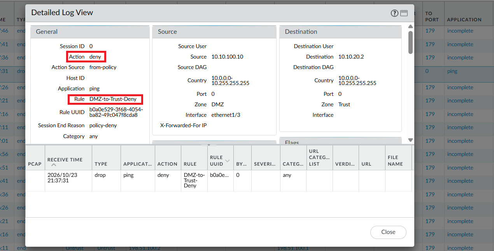
* Action `deny`, rule `DMZ-to-Trust-Deny`. Source 10.10.100.10 (DMZ) to 10.10.20.2 (Trust) blocked.

### 6.5 Destination NAT
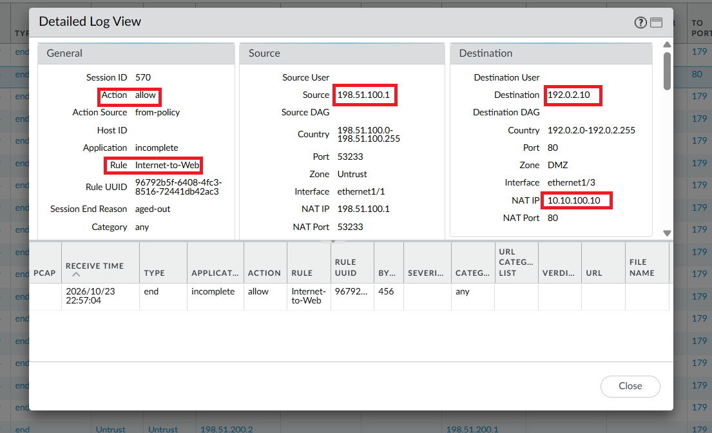
* Application `web-browsing`, action `allow`, rule `Internet-to-Web`. Original: 198.51.100.1 to 192.0.2.10:80. Translated destination: 10.10.100.10:80 (DMZ).

---

## 7. WAN Failover and Failback

### 7.1 BGP Events
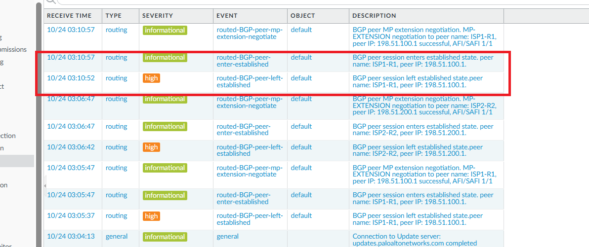
* Administratively downing the ISP1 link produced `routed-BGP-peer-left-established` (at 03:05:37 and 03:10:52). Following link restoration, the session returned to Established within approximately 10 seconds.

### 7.2 Traffic Behavior
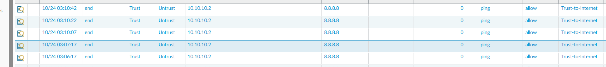  
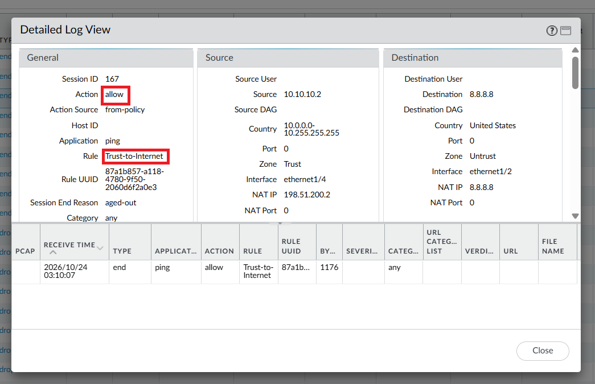  
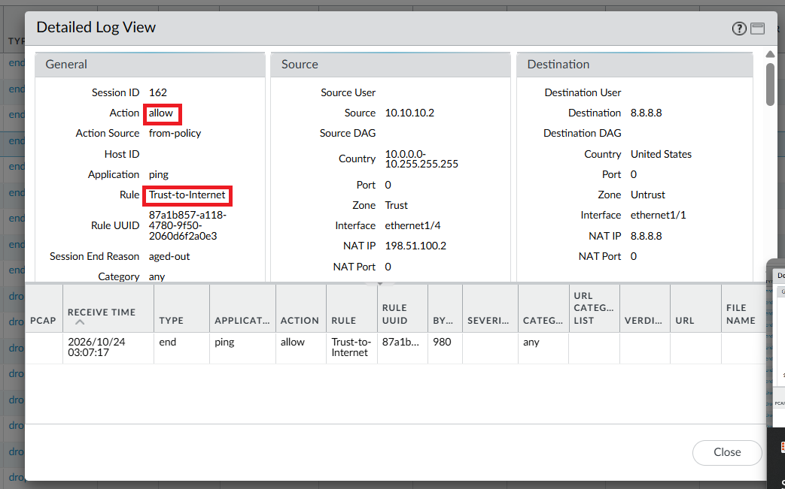

* **Failover:** While ISP1 was down, outbound sessions dynamically routed via `ethernet1/2` and translated to `198.51.200.2`, confirming `SNAT-via-ISP2` engages without manual intervention.
* **Failback:** Once ISP1 recovered, its higher local preference restored it as the active exit; sessions returned to `ethernet1/1` utilizing NAT address `198.51.100.2`.
* **Measured Loss:** 3 ICMP packets lost out of 100 sent during a continuous ping from the IT host to 8.8.8.8 (average ~3 seconds convergence).

---

## 8. Perimeter Defense: Reconnaissance and SYN Flood

### 8.1 Attack Simulation (Kali Linux)

* The attacker (172.16.0.2) targeted the public VIP 192.0.2.10.
* A standard `nmap -sS` scan was blocked; `nmap -Pn -sS` was utilized to bypass ping probes.
* Flood execution: `sudo hping3 -S -p 80 --flood 192.0.2.10` pushed ~3.59 million SYN packets.

### 8.2 Port-Scan Protection
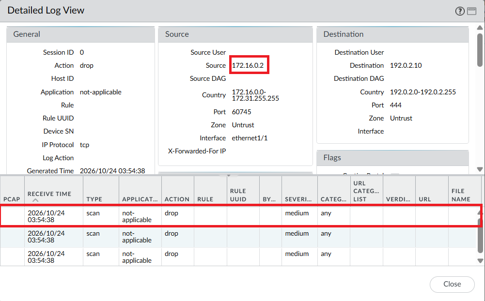
* At 03:54:38, the firewall logged the scan as type `scan`, severity `medium`, action `drop`.
* **Session ID is 0** and the Rule column is blank, demonstrating that the Zone Protection profile mitigates the threat at the ingress stage before session allocation or policy lookup.

### 8.3 SYN Flood Protection
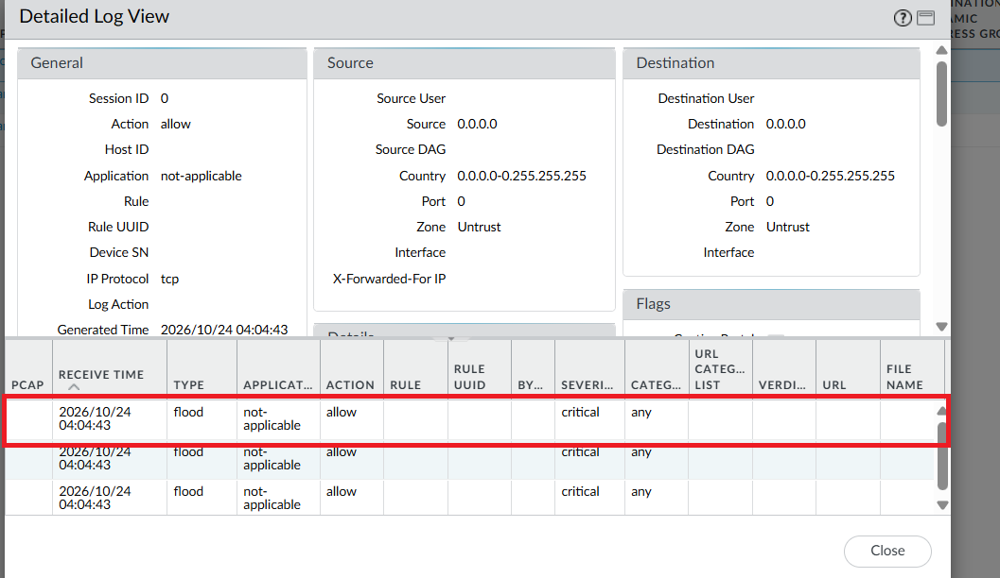
* The flood was identified as type `flood`, severity `critical`, session ID `0`. The Zone Protection profile leverages cryptographic **SYN Cookies**, safeguarding firewall and server resources from TCP backlog exhaustion.

---

## 9. Limitations
* **Virtual Environment:** Executed entirely in EVE-NG; throughput, scale, or hardware-specific production behaviors are not claimed.
* **Inter-VLAN Routing:** VLANs 10, 20, and 30 are routed at the core layer. Firewall policy enforcement operates strictly at the macro-zone level (Trust / DMZ / Untrust), not laterally between campus VLANs.
* **Single Firewall:** Hardware constraints prevented deploying an HA pair (Active/Passive); link and path monitoring were studied conceptually.
* **Licensing:** Without an active Threat Prevention license, L7 signature IPS functions were bypassed at the dataplane.
* **Simulated Internet Routing:** The public VIP is advertised as a /32 host route. Production ISPs typically drop prefixes longer than /24.

---

## 10. Issues Encountered and Resolutions

| Issue | Cause | Resolution |
| :--- | :--- | :--- |
| ISP did not see 192.0.2.0/24 | Loopback addresses are installed as /32 on PAN-OS, so the /24 redistribution rule matched nothing. | Advertised the /32 host route instead. |
| Commit failed: "Failed to add route 192.0.2.0/24 in export rule... same static route is configured to discard" | A static discard route for the same prefix conflicted with BGP export logic. | Removed the static discard route. |
| Warnings: BGP import/export policy "not used by any peer-group" | Rules were created but not actively bound to a peer group. | Bound each rule to its respective peer group via *Used By*. |
| Ping to 192.0.2.10 got no reply although the traffic log showed allow | Replies to the firewall's own loopback require a management profile permitting ICMP. | Applied the `ALLOW-PING` management profile to the loopback. |
| `test nat-policy-match` returned No-NAT; `show running nat-policy` lacked a translate-to line | The DNAT rule possessed match conditions but the Translated Packet configuration was empty. | Set Destination Address Translation to Static IP `WEB-DMZ`, port 80/443. |
| Commit failed: "Mismatch of destination address translation range" on `SNAT-via-ISP1` | A destination translation was erroneously present on a dynamic source NAT rule. | Retained source translation solely on SNAT rules; destination translation solely on DNAT rules. |

---

## 11. Acceptance Matrix

| Test ID | Objective | Method | Result |
| :--- | :--- | :--- | :--- |
| **TC-01** | OSPF with both cores, default route injection | OSPF Area 0, p2p links, passive DMZ, RP-BGP-DEF exported as ext-2. | Full adjacency with 10.255.255.2 and 10.255.255.3. |
| **TC-02** | Dual-ISP eBGP and export filtering | eBGP to AS 65001 and AS 65002, max-prefix, export whitelist. | Both peers Established; external routing table cleanly filtered. |
| **TC-03** | Zone policy and NAT | IT/HR to DMZ, Trust to Internet, Internet to web VIP. | IT allowed; HR denied; DMZ lateral movement denied; DNAT successful to 10.10.100.10:80. |
| **TC-04** | ISP failover and failback | Dropped ISP1 link during continuous ping, subsequently restored. | Sessions dynamically moved to `ethernet1/2` (198.51.200.2) and back to `ethernet1/1` (198.51.100.2); negligible packet loss. |
| **TC-05** | Recon and SYN flood protection | `nmap -Pn -sS` and `hping3 --flood` from Kali Linux. | Scan dropped pre-session (scan, drop, session 0); flood mitigated via SYN cookies (flood, critical, session 0). |

---

## 12. Skills Demonstrated
* **Routing Architecture:** Dual-homed eBGP edge combined with internal OSPFv2, featuring controlled redistribution and rigorous export filtering.
* **PAN-OS Packet-Flow Logic:** Mastery of pre-NAT address and post-NAT zone evaluations, per-egress-interface SNAT, and CLI diagnostics (`test nat-policy-match`, `show running nat-policy`).
* **Zero Trust Policy:** Implementation of zone-based least-privilege App-ID rules and hardware-optimized ingress protection using Zone Protection profiles.
* **Methodical Execution:** Structured deployment, disciplined naming conventions (Object-Oriented Policy Management), and systematic troubleshooting documentation.
